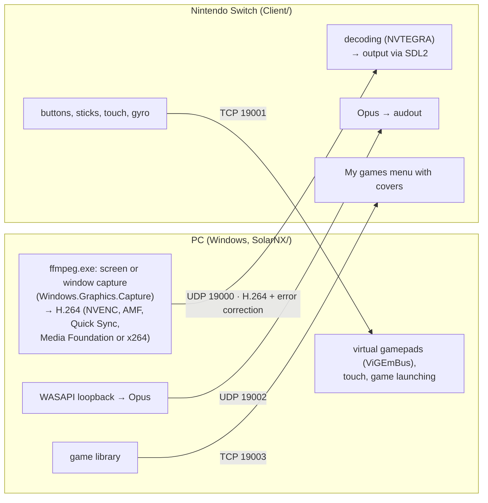

[Русский](architecture.md) | **English**

# How it works

## Components

The PC opens all TCP connections: the Switch only listens on its ports, so the PC doesn't need to
accept incoming connections. Video, audio and input are three independent streams with no shared
synchronization.

## PC: SolarNX (`SolarNX/`)

C#, .NET 10, WPF user interface.

- `AppOrchestrator.cs` is the center of the app: when a session starts or ends, it starts and stops
  capture, audio, gamepads and the selected app.
- `Session/`: the connection to the Switch over the HID port; a session starts with the first input
  packet. Adaptive bitrate.
- `Capture/`: the `ffmpeg.exe` process (`VideoEncoder.cs`) and sending video to the Switch with
  error correction (`VideoSender.cs`, `ReedSolomon.cs`).
- `Audio/`: audio capture, Opus encoding, packing into RTP-like packets.
- `Input/`: input packet parsing, Xbox 360 / DualShock 4 virtual gamepads, the Steam button
  gesture, touch.
- `BigPicture/`: starting Steam and Big Picture, tracking the running game.
- `Library/`: the game library: storage, launching every game type, sending the list and covers to
  the Switch.
- `ShadPs4/`: starting shadPS4.
- `Native/`: Windows helpers: child processes, game process tracking, window geometry.

SolarNX doesn't inject anything into game processes or read their memory: games are only launched,
and SolarNX watches them with minimal access rights. This matters for games with anti-cheat.

## Switch: client (`Client/`)

C, devkitPro / libnx.

- `main.c`: startup, threads, the "menu → streaming → menu" loop.
- `network/`: accepting the input connection, packet format.
- `video/`: receiving video, rebuilding lost packets, hardware decoding (separate decode and
  output threads).
- `audio/`: receiving and playing audio.
- `input/`: reading gamepads, touch screen and gyro; the back-to-menu gesture.
- `menu/`: the mode selection menu and the library grid.
- `library/`: receiving the game library from the PC.

## Video

ffmpeg encodes the picture to H.264 and hands the frames to SolarNX. SolarNX cuts each frame into
1280-byte packets and adds about 20% extra packets computed with a Reed–Solomon code. If some of a
frame's packets are lost on the way, the Switch rebuilds them from the extra ones without asking
the PC again. Big frames are split into several blocks; their packets are sent interleaved and
spread over a few milliseconds, so a burst of losses doesn't land on one block.

If a frame can't be rebuilt, the Switch doesn't hand it to the decoder: until the next keyframe (at
most half a second) the last whole frame stays on screen, without smeared artifacts. The Switch
reports how many packets it rebuilt and how many frames it lost in its input packets; the PC writes
that to its log and takes it into account for adaptive bitrate.

The format is described in `SolarNX/Capture/VideoSender.cs` and `Client/video/videowire.h`.

## Input protocol

After connecting, the PC sends the Switch the session parameters (28 bytes: bitrate, resolution,
frame rate, audio parameters). From then on the Switch sends an input packet about 120 times per
second: an 8-byte `0xFF` marker and 224 bytes of data, holding the state of up to 4 gamepads, touch,
the selected mode, the library game number and link quality counters for adaptive bitrate.

The formats are written by hand on both sides: `SolarNX/Input/HidProtocol.cs` and
`Client/network/network.h`. The PC and the Switch share no build, so any format change must be made
in both parts at once.

More details for developers are in [DEVELOPMENT.en.md](../DEVELOPMENT.en.md) and in the notes under
`.claude/skills/`.
