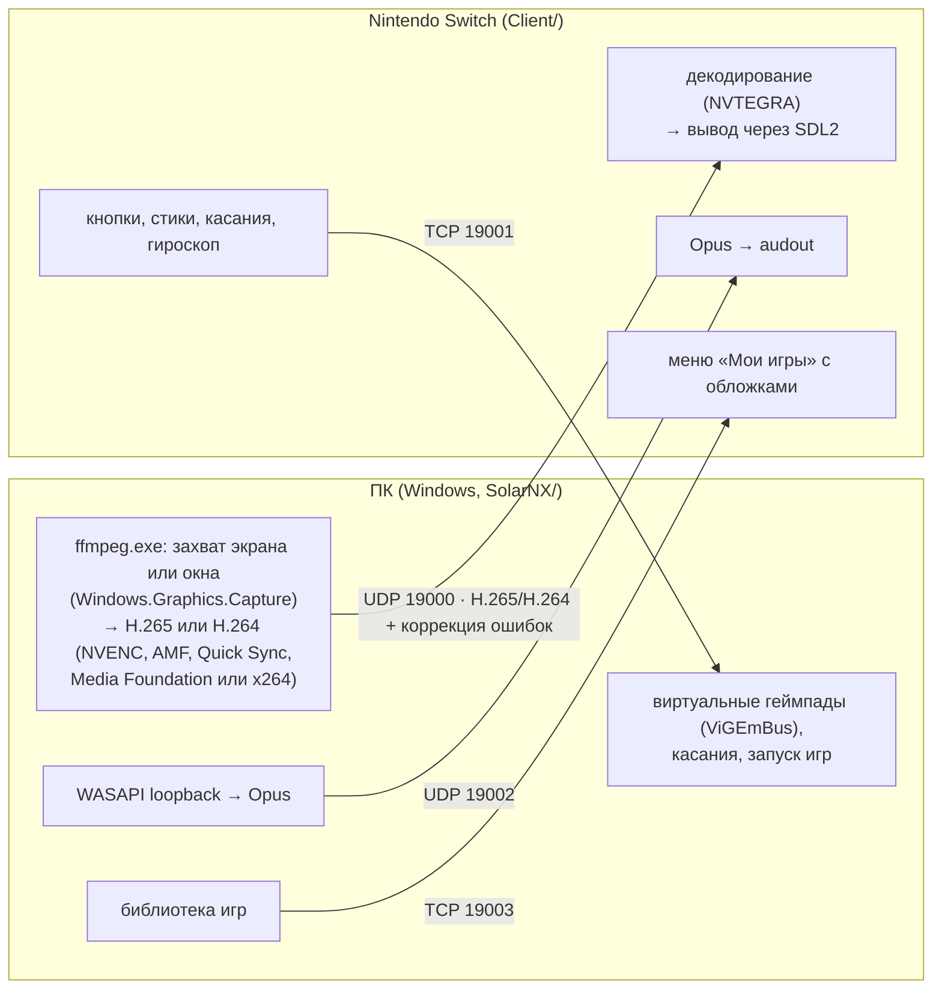

**Русский** | [English](architecture.en.md)

# Как это устроено

## Компоненты

Все TCP-соединения устанавливает ПК: Switch только слушает порты, поэтому на ПК не нужно открывать
входящие подключения. Видео, звук и управление — три независимых потока без общей синхронизации.

## ПК: SolarNX (`SolarNX/`)

C#, .NET 10, интерфейс на WPF.

- `AppOrchestrator.cs` — центр приложения: по началу и концу сессии запускает и останавливает
  захват, звук, геймпады и выбранное приложение.
- `Session/` — подключение к Switch по HID-порту; сессия начинается с первого пакета управления.
  Адаптивный битрейт.
- `Capture/` — процесс `ffmpeg.exe` (`VideoEncoder.cs`) и отправка видео на Switch с коррекцией
  ошибок (`VideoSender.cs`, `ReedSolomon.cs`).
- `Audio/` — захват звука, кодирование Opus, упаковка в RTP-подобные пакеты.
- `Input/` — разбор пакетов управления, виртуальные геймпады Xbox 360 / DualShock 4, жест кнопки Steam,
  касания.
- `BigPicture/` — запуск Steam и Big Picture, отслеживание запущенной игры.
- `Library/` — библиотека игр: хранение, запуск всех типов, передача списка и обложек на Switch.
- `ShadPs4/` — запуск shadPS4.
- `Native/` — вспомогательные функции Windows: дочерние процессы, отслеживание процессов игры,
  геометрия окон.

SolarNX ничего не внедряет в процессы игр и не читает их память: игры только запускаются, а за их
работой SolarNX следит с минимальными правами доступа. Это важно для игр с античитом.

## Switch: клиент (`Client/`)

C, devkitPro / libnx.

- `main.c` — запуск, потоки, цикл «меню → трансляция → меню».
- `network/` — приём подключения управления, формат пакетов.
- `video/` — приём видео, восстановление потерянных пакетов, аппаратное декодирование (отдельные
  потоки декодирования и вывода).
- `audio/` — приём и воспроизведение звука.
- `input/` — чтение геймпадов, сенсорного экрана, гироскопа; жест возврата в меню.
- `menu/` — меню выбора режима и сетка библиотеки.
- `library/` — приём библиотеки игр от ПК.

## Видео

ffmpeg кодирует картинку в H.265 (или H.264) и отдаёт кадры SolarNX. SolarNX режет каждый кадр на пакеты по
1280 байт и добавляет к ним примерно 20 % избыточных пакетов, посчитанных кодом Рида — Соломона.
Если по дороге часть пакетов кадра потерялась, Switch восстанавливает их из избыточных, не
переспрашивая ПК. Большие кадры делятся на несколько блоков, их пакеты отправляются вперемешку и
растягиваются на несколько миллисекунд, чтобы пачка потерь не пришлась на один блок.

Если кадр восстановить не удалось, Switch не отдаёт его декодеру: до ближайшего ключевого кадра (не
дольше полсекунды) на экране остаётся последний целый кадр, без размазанных артефактов. Сколько
пакетов восстановлено и сколько кадров потеряно, Switch сообщает ПК в пакетах управления; ПК пишет это
в журнал и учитывает в адаптивном битрейте.

Формат описан в `SolarNX/Capture/VideoSender.cs` и `Client/video/videowire.h`.

## Протокол управления

После подключения ПК отправляет Switch параметры сессии (28 байт: битрейт, разрешение, частота кадров,
параметры звука). Дальше Switch примерно 120 раз в секунду отправляет пакет управления: 8 байт
маркера `0xFF` и 224 байта данных — состояние до 4 геймпадов, касание, выбранный режим, номер игры из
библиотеки и счётчики качества связи для адаптивного битрейта.

Форматы описаны вручную с обеих сторон: `SolarNX/Input/HidProtocol.cs` и `Client/network/network.h`.
Общей сборки у ПК и Switch нет, поэтому любое изменение формата нужно вносить в обе части сразу.

Подробности для разработчиков — в [DEVELOPMENT.md](../DEVELOPMENT.md) и в описаниях в папке
`.claude/skills/`.
