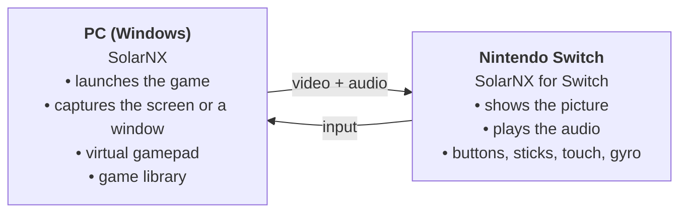
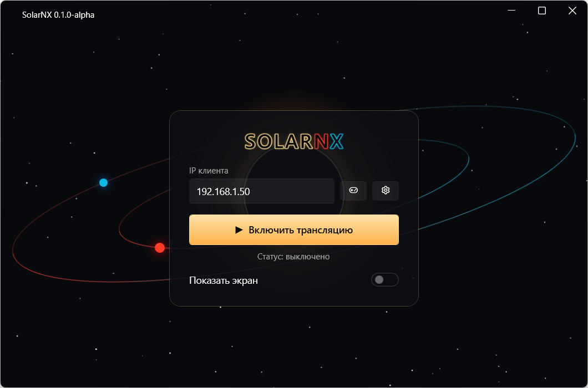
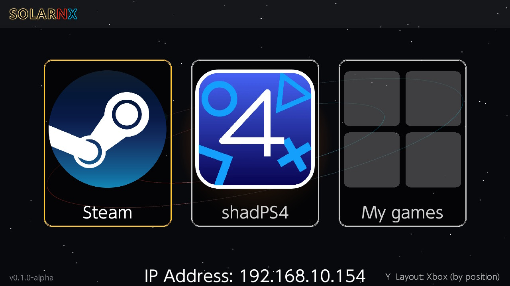
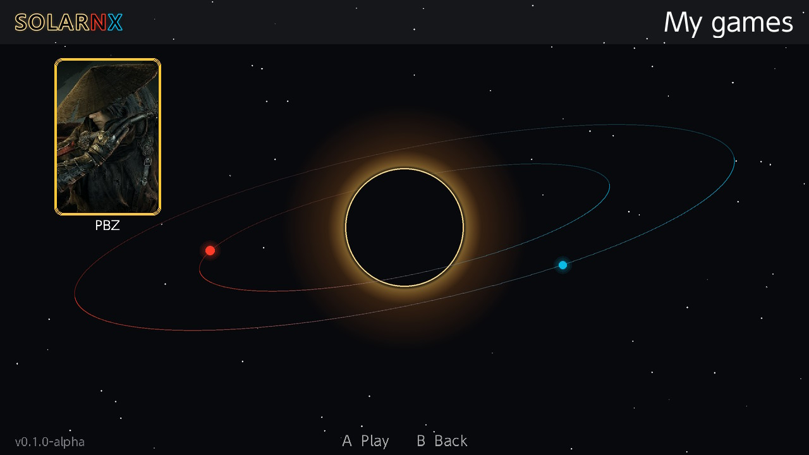
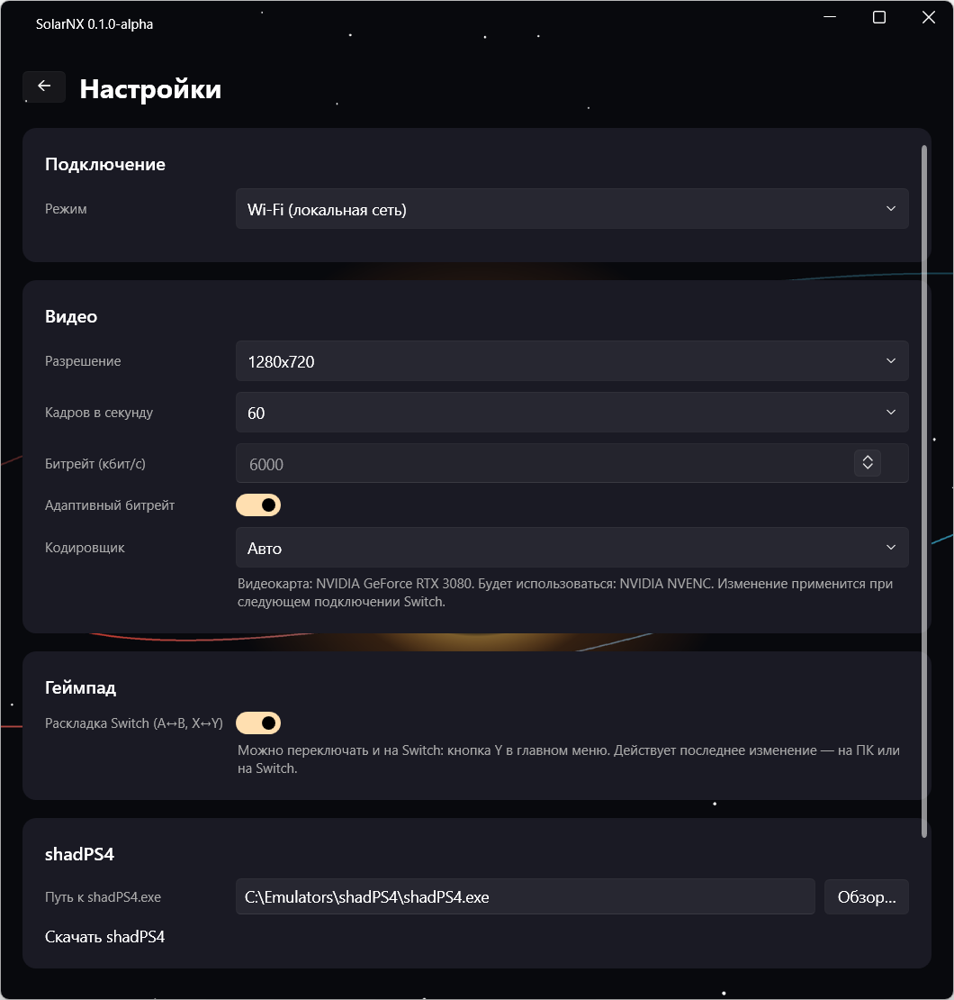
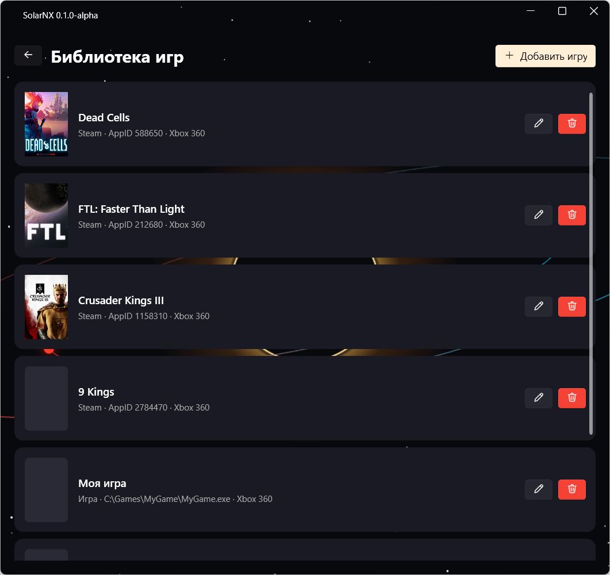
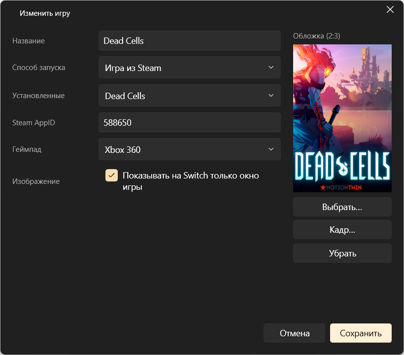
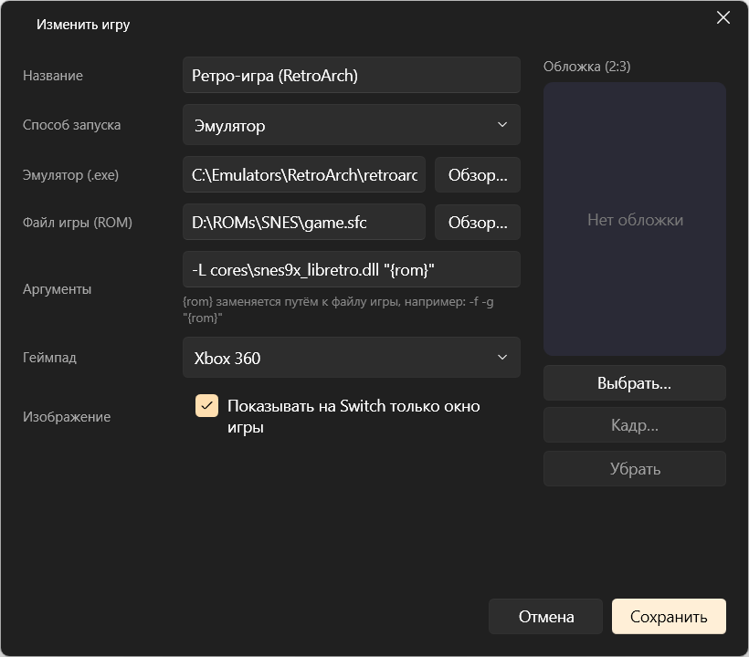
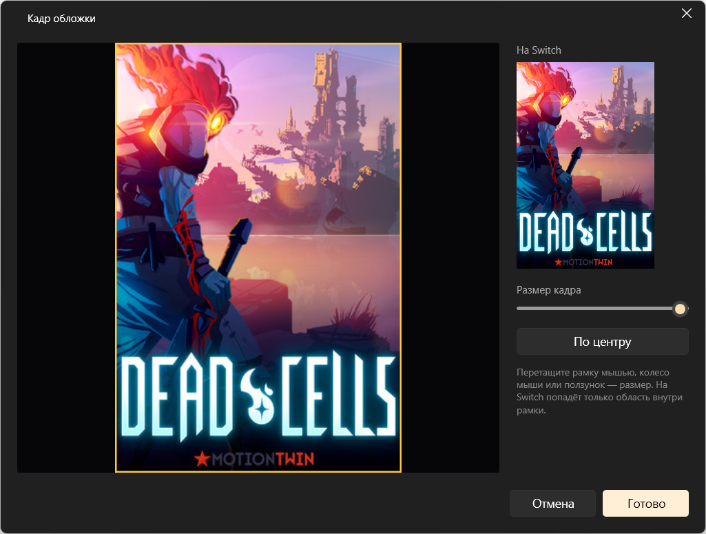

[Русский](features.md) | **English**

# SolarNX features

## What it looks like

SolarNX runs on two devices on the same network: the PC runs the game and sends video and audio; the
Switch shows them and sends input back.

### Example: launching a game from your library

**1. On the PC**: the Switch's IP address is entered in SolarNX and streaming is on.

**2. On the Switch**: open SolarNX and pick a mode. The console's IP address is shown at the bottom of
the screen.

**3. My games**: pick a game from the library you put together on the PC.

**4. The game**: the PC starts the game and it appears on the Switch screen. Play with the Joy-Con or
a Pro Controller.

To return to the menu, hold − for 3 seconds; the game on the PC closes. If you close the game on the
PC, the Switch returns to the menu by itself.

## The PC app

### Main screen

- The **Client IP** field: the Switch's address (remembered).
- **Start streaming** / **Stop streaming**: while streaming is
  on, SolarNX waits for the Switch and connects to it automatically, including after dropouts.
- **Status**: off / waiting for connection / streaming (with the mode name).
- **Show screen**: a preview of what is being sent.
- Buttons for the **game library** (gamepad) and **settings** (gear).
- Closing the window minimizes it to the tray; to quit completely, use the tray → Exit.

### Settings

- **Video:** resolution (640×360 to 1920×1080), frame rate (24, 30, 45, 60), bitrate.
- **Encoder:** Auto or a specific one; the line under the list shows the detected graphics card and the encoder that will be used.
- **Codec:** H.265 (the default) or H.264.
- **Adaptive bitrate:** if packets are lost on the Switch, SolarNX lowers the bitrate (no lower than
  1500 kbps), and after 30 seconds of stable connection carefully raises it back to the configured
  value.
- **Switch layout:** swaps A/B and X/Y. Can be changed both on the PC and on the Switch (Y in the menu).
- **shadPS4:** path to the emulator (found automatically) and a download link.
- **Drivers:** reinstalling ViGEmBus.

### Game library

A list of your games with covers. You can edit or delete each one; changes go to the Switch right away.

- **Four launch methods:** regular game (`.exe` with arguments and working folder), Steam game
  (picked from the installed ones), emulator (with an argument template using `{rom}`), custom cmd
  script.
- **Gamepad type** per game: Xbox 360 or DualShock 4 with gyro.
- **Capture only the game window:** the game fills the Switch screen even if it runs in a window on
  the PC.
- **Cover:** any image; for Steam games it's filled in automatically.

- **Cover framing:** which part of the image to show on the Switch, with a preview.

More in [Game library](library.en.md).

### What SolarNX does while streaming

**Modes**
- **Steam** starts Steam (if it isn't running) and opens Big Picture. It tracks games starting and
  closing; after you quit a game, Steam returns to Big Picture by itself. If Big Picture is closed on
  the PC, the session ends.
- **shadPS4** starts the emulator in its gamepad mode.
- **Your own game** is started the right way, and SolarNX tracks its process, including processes the
  launcher started. The game window gets focus, and capture switches to that window, even if it
  changes (launcher → game, resolution change).
- When the Switch disconnects or goes back to the menu, SolarNX closes the running game, exits
  Big Picture (Steam itself keeps running) or closes shadPS4.

**Video**
- Captures the primary monitor or the game window through Windows.Graphics.Capture.
- Encodes H.265 (the default) or H.264 on the graphics card with minimal latency: NVIDIA (NVENC), AMD (AMF), Intel (Quick Sync),
  or through Media Foundation on any other graphics card. SolarNX finds the graphics card itself and checks
  which encoder works on it; the CPU is used only when none of them does. AMD and Intel are
  experimental: not tested on real graphics cards yet. H.265 gives a noticeably better picture at the
  same bitrate; if the encoder can't do it, the video goes in H.264. The Switch decodes both in hardware.
- If capture freezes (this happens when games switch fullscreen mode), SolarNX restarts it by
  itself.

**Audio**
- Everything playing on the default output device is captured and sent as Opus at 128 kbps.

**Input**
- Up to 4 virtual Xbox 360 or DualShock 4 gamepads (ViGEmBus driver).
- Steam / PS button with − and + together.
- Touches on the Switch screen become touches on the PC (on a game window, taking its position into
  account).
- Gyro and accelerometer in DualShock 4 mode.

**System**
- While streaming, SolarNX raises its priority and the system timer resolution so audio and video
  don't stutter under game load.
- Turns off the Xbox Game Bar popup that Windows shows when a gamepad connects.
- Doesn't inject into game processes or read their memory; this matters for games with anti-cheat.
- If SolarNX crashes, the video encoding process exits with it.

## The Switch app

**Menu**
- Three tiles: Steam, shadPS4, My games. The console's IP address is shown at the bottom of the
  screen.
- Y switches the A/B and X/Y layout; the current one is shown in the bottom-right corner.
- X opens the connection settings: Wi-Fi or the experimental Internet mode.
- My games is a grid of your library's covers: A to play, B to go back. The list comes from the PC
  automatically and updates by itself.

**Streaming**
- Hardware video decoding; the newest frame is always the one shown, so latency doesn't build up.
- Audio with packet loss concealment: short gaps are inaudible.
- After a dropout, the app waits for a new connection by itself.

**Input**
- Up to 4 controllers: Joy-Con (as a pair or single), Pro Controller, the console in handheld mode.
- Touch screen and gyro.
- Hold − for 3 seconds to return to the menu; close the app with the HOME button.

**Launching**
- From the Homebrew Menu or from a HOME menu tile (forwarder); see [Installation](installation.en.md).

## Limitations

- Captures the PC's primary monitor (or the game window).
- By default the resolution follows the Switch screen: 1280×720 handheld, 1920×1080 docked.
- A minimized game window sends no picture; some games in exclusive fullscreen mode are only visible
  when capturing the whole monitor.
- The ZL/ZR triggers are sent as on/off presses, without pressure.
- Picture quality depends on Wi-Fi: 5 GHz is better, with the PC wired to the router.
