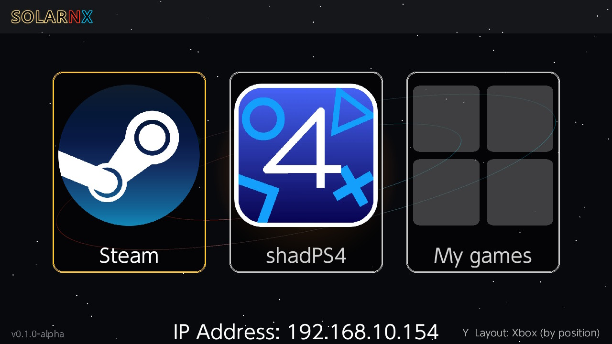
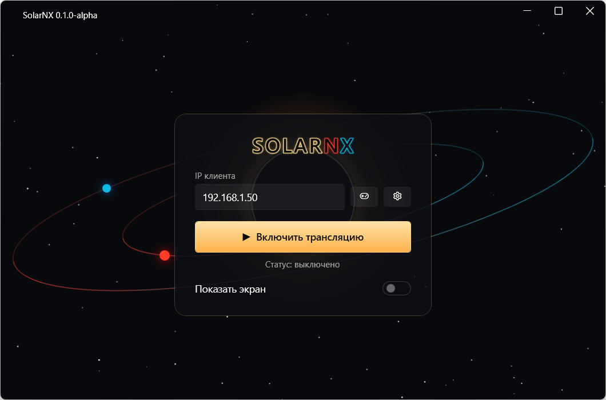
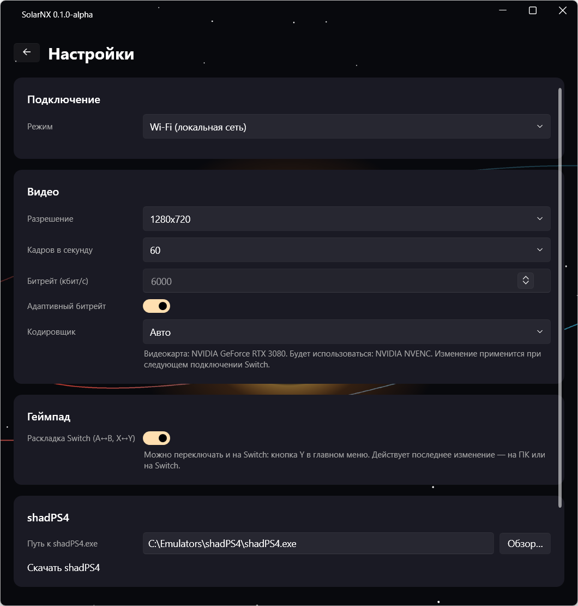

[Русский](usage.md) | **English**

# Usage

## First connection

1. Start SolarNX on the Switch. The console's IP address is shown at the bottom of the menu
   (`IP Address: …`).

   

2. On the PC, open SolarNX, enter that address in the **Client IP** field and click
   **Start streaming**. The address is remembered.

   

3. On the Switch, choose what to play (see below). The PC starts the right app, and the picture
   appears on the Switch within a few seconds.

The status under the button shows what's happening: off, waiting for the client (the PC is waiting
for the Switch) or client connected, streaming, with the mode name.

## Modes

The Switch menu has three tiles:

- **Steam** opens Steam Big Picture on the PC. From there it's regular Big Picture: library, store,
  launching games. After you quit a game, Steam returns to Big Picture by itself.
- **shadPS4** starts the PlayStation 4 emulator in its gamepad mode. The path to `shadPS4.exe` is set
  in Settings → SolarNX tries to find it by itself. In this mode the gamepad
  is a virtual DualShock 4 with gyro.
- **My games** is your own game library with covers. How to fill it is described in
  [Game library](library.en.md). When the game closes on the PC, the Switch returns to the menu.

## Controls

- The Switch buttons, sticks and triggers work as an Xbox 360 gamepad (or a DualShock 4, in shadPS4
  and in library games where it's selected). The ZL/ZR triggers are digital: pressed or released.
- You can connect up to 4 gamepads; each one becomes a separate virtual controller.
- The Switch **touch screen** works as touch on the PC screen (in library games, on the game window).
- **Gyro** is only sent in DualShock 4 mode.

### Gestures

The Switch system keeps the HOME and Capture buttons for itself, so SolarNX uses gestures instead:

| Gesture | Action |
|---|---|
| **−** and **+** together | Steam (Guide) button: the Steam menu in Big Picture; on DualShock 4, the PS button |
| hold **− for 3 seconds** | back to the SolarNX menu on the Switch. On the PC, the running game (and Big Picture) is closed |
| **−**, **+**, **ZL** and **ZR** together | the debug menu - only while Debug mode is on on the PC (see below) |

A single − or + press is delayed by up to 0.1 seconds, while SolarNX waits to see whether the second
button follows. In debug mode, by up to 0.2 seconds.

### Rumble

The game's rumble goes to the Joy-Con or Pro Controller of the player whose virtual controller
rumbles. On the Switch itself: **X** → Rumble - all (the default), strong only, or off. Strong only
drops weak rumble - useful when a game keeps a weak background rumble up all the time. In some games
the hits are the weak ones, though: then those are what goes. On the PC it can be turned off
entirely: Rumble on the Switch. Needs SolarNX 0.2.5 or newer on both the Switch and the PC. If it keeps going in short jolts,
turn debug mode on: its Rumble line shows how many rumble commands come from the PC.

### Button layout on the Switch

In the Switch main menu, press **Y** to switch the A/B and X/Y layout. The current layout is shown in the
bottom-right corner:

- **Layout: Switch (A = A)**: the buttons match the labels on the Switch; press A and the game gets A.
- **Layout: Xbox (by position)**: the buttons match an Xbox gamepad by position; the right button is A.

This is the same setting as Switch layout on the PC: the Switch and the PC exchange
it while streaming is on, and the last change wins, wherever it was made. Syncing takes a few seconds.
The Switch keeps the setting on the SD card in `/switch/SolarNX/settings.cfg`.

### Language on the Switch

The Switch app uses the console's language: Russian if the console is set to Russian, English
otherwise. To change it, in the main menu press **X** → Language (Auto → Русский → English).

## PC settings

The gear button on the SolarNX main screen.

| Setting | What it does |
|---|---|
| Interface language | Same as Windows (the default), Russian or English. Changes at once, no restart needed |
| Resolution | size of the streamed picture. Auto (the default) follows the Switch screen: 1280×720 handheld, 1920×1080 docked. If you put the Switch in the dock or take it out mid-game, the picture freezes for about a second and goes on at the new resolution. 1080p needs a higher bitrate, about twice as much. A fixed resolution can be chosen too |
| Frames per second | 60 is smoother; 30 halves the network load and gives a sharper picture at the same bitrate |
| Bitrate (kbps) | video quality. Higher is sharper but harder on Wi-Fi. Lower it if you see artifacts |
| Adaptive bitrate | SolarNX lowers the bitrate when the connection has problems and raises it back once things are stable. The Bitrate value becomes the upper limit |
| Encoder | Auto (recommended): SolarNX picks the encoder for your graphics card itself. The line under the list shows the detected graphics card and the encoder that will be used. Choose one by hand only if the automatic one causes problems, such as artifacts. The AMD and Intel encoders are experimental. Takes effect the next time the Switch connects |
| Codec | H.265 (the default): a noticeably better picture at the same bitrate. H.264: if H.265 causes problems. If the selected encoder can't do H.265, the video goes in H.264; the line under the encoder shows it. Takes effect the next time the Switch connects |
| Switch layout (A↔B, X↔Y) | swaps A/B and X/Y so the buttons match the labels on the Switch. The same setting can be changed on the Switch (see below); the last change wins |
| Rumble on the Switch | the game's rumble on the Joy-Con or Pro Controller. On by default |
| Traffic priority | video, audio and input are marked as urgent: a router with WMM lets them ahead of other traffic on Wi-Fi. On by default, Wi-Fi mode only. If things get worse, turn it off |
| Check for updates | at start-up and once a day SolarNX looks at the list of releases on GitHub and shows on the main screen when a new version is out, and whether the Switch app needs updating too. Nothing is downloaded by itself. Check now works even with the check turned off |
| Debug mode | statistics over the video on the Switch, and the debug menu (see below). Off by default |
| Adaptive NVENC preset | NVIDIA graphics cards only, on by default. Starts at the best quality (p7, hq); if the graphics card can't keep up with encoding, the preset goes down step by step, and after a couple of minutes running smoothly SolarNX tries to raise it again. Each change freezes the picture for about a second. The network is handled by adaptive bitrate |
| NVENC preset and tuning | shown in debug mode; a manual choice turns the adaptive preset off, NVIDIA graphics cards only. Preset p1 is the fastest, p7 the best quality (p4 by default). Tuning: ll is low latency (default), ull even lower, hq quality. Applies at once, the picture freezes for about a second |
| shadPS4 | path to the emulator |
| Drivers | reinstalls ViGEmBus |

The **Show screen** toggle on the main window shows a preview of what the Switch
sees.

## Versions on the PC and the Switch

Normally the PC and the Switch should run the same SolarNX version. Since 0.2.5 they also check each
other when they connect:

- If nothing changed in how they talk to each other, different versions work together - the Switch
  app doesn't have to be updated.
- If something small changed, they still work, without the new features of the older side. The PC's
  main screen and the Switch's menu say what to update.
- If something important changed, streaming won't start, and both sides say what to update.

A Switch with SolarNX 0.2.4 works with a PC on 0.2.5 without rumble, debug mode and traffic priority.
With older versions (0.2.3 and earlier) there will be no video: update both sides.

With Check for updates on, the new-version notice on the PC says right away whether the Switch app
has to be updated too.

## Debug mode

Turn it on on the PC: Settings → Debug → Debug mode. While streaming, the Switch shows over the video:

- the encoder, codec, resolution, frame rate and NVENC preset;
- how many frames per second are shown, how many are lost and how many packets are rebuilt;
- the bitrate and the decode time on the Switch;
- the latency from the PC sending a frame to the Switch showing it (encoding on the PC isn't
  included yet), and the network round trip;
- which controllers are connected and what the Switch sees them as (Pro Controller, Joy-Con,
  GameCube...);
- the current rumble level and how many rumble commands per second come from the PC.

Pressing **−**, **+**, **ZL** and **ZR** together opens the debug menu. Select and change with the
D-pad: statistics on screen, bitrate, adaptive bitrate, codec, resolution, frames per second, adaptive
preset, NVENC preset and tuning, traffic priority. A change goes to the PC after a fraction of a second, is saved in
its settings, and the video restarts with it - the picture freezes for about a second. The game gets
no input while the menu is open. B or the same combination closes it.

## Playing over the internet (experimental)

> **Experimental feature.** Internet mode hasn't been tested on many networks and routers yet. The
> regular Wi-Fi mode works as before and doesn't depend on this mode.

In Internet mode the Switch connects to the PC over the internet on a single UDP port, **19010**.
Everything goes through that one connection: input, video, audio and the library, and all of it is
**encrypted**. Only a Switch paired with the PC once can connect. There is no NAT hole punching yet, so
the port has to be forwarded on the router by hand.

**Setup (once):**
1. **PC:** Settings → Connection → Mode → **Internet
   (experimental)**. On the router, forward **UDP port 19010** to this
   PC. Turn streaming on; allow SolarNX through Windows Firewall if it asks.
2. **Switch:** in the main menu press **X** to open the Settings screen. **Mode** → Internet,
   **PC address**: the PC's public IP address or a domain (if the router uses a different port, add it
   after a colon, `example.com:19010`). Restart SolarNX on the Switch: the mode is picked at startup.
3. **Pairing.** On the PC: Settings → Connection → **Pair Switch…**; the
   window waits 2 minutes for a request. On the Switch: X → **Pair with this PC**. Both screens show
   the same 6-digit code. If the codes match, click **Codes match — pair** on the PC.

From then on the Switch connects by itself. The bottom-right corner of the menu shows "X  Internet: …":
"connected (encrypted)" (all good), "waiting for the PC" (the PC doesn't answer: check the address and
the port forwarding), "not paired" (pairing needed).

> Pair only if the codes match. Different codes mean someone is sitting between the Switch and the PC.
> The paired Switches are listed in the same Connection card; Forget all removes every
> pairing.

Don't want to forward a port, or your provider gives you a shared address? Run your own rendezvous
server: [Server for playing over the internet](server.en.md).

To go back to Wi-Fi: choose «Wi-Fi» on the PC, Mode → Wi-Fi on the Switch, and restart the app.

## Stopping

- On the Switch: hold − for 3 seconds to return to the menu, or close the app with HOME.
- On the PC: Stop streaming. If a game was running, SolarNX closes it and
  exits Big Picture.
