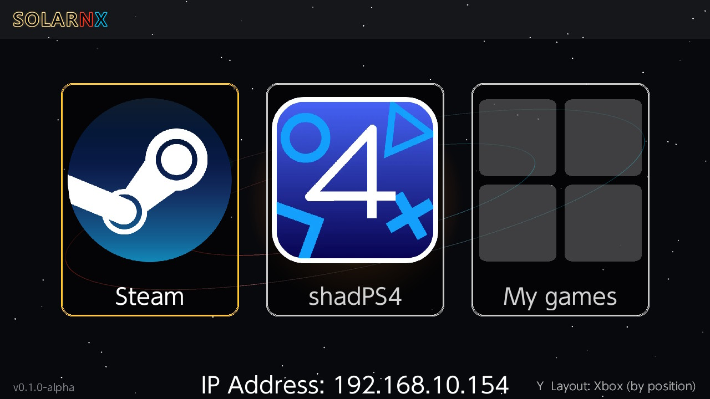
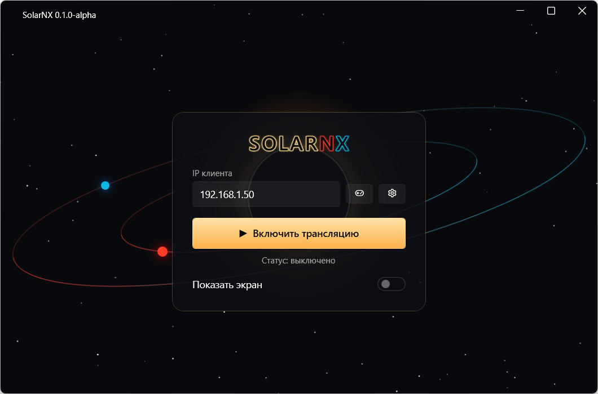
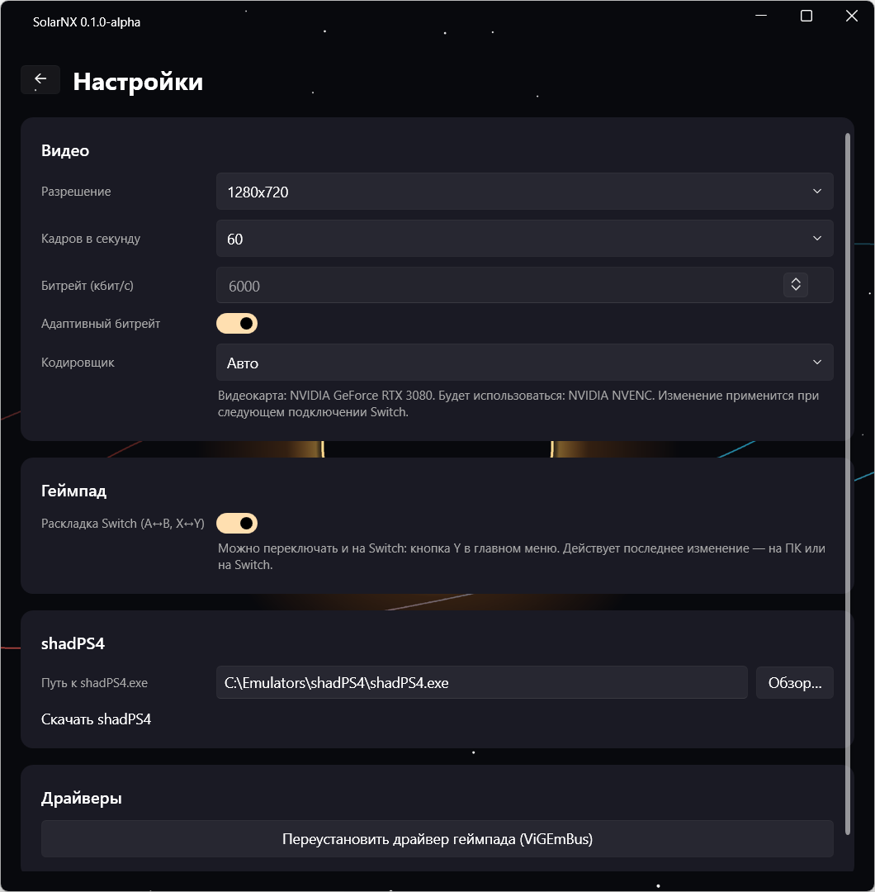

**Русский** | [English](usage.en.md)

# Использование

## Первое подключение

1. Запустите SolarNX на Switch. Внизу экрана меню показан IP-адрес консоли (`IP Address: …`).

   

2. На ПК откройте SolarNX, впишите этот адрес в поле **«IP клиента»** и нажмите
   **«▶ Включить трансляцию»**. Адрес запоминается.

   

3. На Switch выберите, во что играть (см. ниже). ПК запустит нужное приложение, и через несколько секунд
   на Switch появится картинка.

Статус под кнопкой показывает, что происходит: «выключено», «ожидание подключения клиента…» (ПК ждёт
Switch) или «клиент подключён, идёт трансляция» (с названием режима).

## Режимы

В меню Switch три плитки:

- **Steam** — открывает Steam Big Picture на ПК. Дальше всё как обычно в Big Picture: библиотека,
  магазин, запуск игр. После выхода из игры Steam сам возвращается в Big Picture.
- **shadPS4** — запускает эмулятор PlayStation 4 в его режиме для геймпада. Путь к `shadPS4.exe`
  задаётся в «Настройки» → «shadPS4» (SolarNX пытается найти его сам). Геймпад в этом режиме —
  виртуальный DualShock 4 с гироскопом.
- **My games** — ваша собственная библиотека игр с обложками. Как её наполнить —
  в [Библиотека игр](library.md). Когда игра закрывается на ПК, Switch сам возвращается в меню.

## Управление

- Кнопки, стики и курки Switch работают как геймпад Xbox 360 (или DualShock 4 — в shadPS4 и в играх
  библиотеки, где он выбран). Курки ZL/ZR цифровые: нажат или отпущен.
- Подключить можно до 4 геймпадов — каждый становится отдельным виртуальным контроллером.
- **Сенсорный экран** Switch работает как касания по экрану ПК (в играх библиотеки — по окну игры).
- **Гироскоп** передаётся только в режиме DualShock 4.

### Жесты

Кнопки «Домой» и «Снимок экрана» система Switch оставляет себе, поэтому вместо них:

| Жест | Действие |
|---|---|
| **«−» + «+»** одновременно | кнопка Steam (Guide) — меню Steam в Big Picture; в DualShock 4 — кнопка PS |
| удерживать **«−» 3 секунды** | выйти в меню SolarNX на Switch. На ПК закрывается запущенная игра (и Big Picture) |

Одиночные «−» и «+» срабатывают с задержкой до 0,1 секунды — SolarNX ждёт, не будет ли нажата
вторая кнопка.

### Раскладка кнопок на Switch

В главном меню Switch нажмите **Y**, чтобы переключить раскладку A/B и X/Y. Текущая раскладка подписана в
правом нижнем углу:

- **Layout: Switch (A = A)** — кнопки совпадают с надписями на Switch: нажали A — игра получила A.
- **Layout: Xbox (by position)** — кнопки совпадают по расположению с геймпадом Xbox: правая кнопка — это A.

Это та же настройка, что «Раскладка Switch» на ПК: Switch и ПК обмениваются ею, пока трансляция
включена, и действует последнее изменение, где бы его ни сделали. Синхронизация занимает несколько
секунд. Switch хранит настройку на карте памяти в `/switch/SolarNX/settings.cfg`.

## Настройки на ПК

Кнопка с шестерёнкой на главном экране SolarNX.

| Настройка | Что делает |
|---|---|
| Разрешение | размер передаваемой картинки. Экран Switch — 1280×720, больше обычно не нужно |
| Кадров в секунду | 60 — плавнее; 30 — вдвое меньше нагрузка на сеть, чётче картинка при том же битрейте |
| Битрейт (кбит/с) | качество видео. Больше — чётче, но тяжелее для Wi-Fi. Если появляются артефакты, уменьшите |
| Адаптивный битрейт | SolarNX сам снижает битрейт при проблемах со связью и поднимает обратно, когда всё стабильно. Значение «Битрейт» становится верхней границей |
| Кодировщик | «Авто» (рекомендуется) — SolarNX сам выбирает кодировщик под вашу видеокарту. Под списком видно, какая видеокарта найдена и какой кодировщик будет работать. Выбирать вручную стоит, только если с автоматическим есть проблемы, например артефакты. Кодировщики AMD и Intel — экспериментальные. Применяется при следующем подключении Switch |
| Раскладка Switch (A↔B, X↔Y) | меняет местами A/B и X/Y, чтобы кнопки совпадали с надписями на Switch. То же самое переключается на Switch (см. ниже) — действует последнее изменение |
| shadPS4 | путь к эмулятору |
| Драйверы | переустановка ViGEmBus |

Переключатель **«Показать экран»** на главном окне показывает превью того, что видит Switch.

## Завершение

- На Switch: удерживайте «−» 3 секунды, чтобы вернуться в меню, или закройте приложение через «Домой».
- На ПК: «Выключить трансляцию». Если в этот момент шла игра, SolarNX закроет её и выйдет из
  Big Picture.
